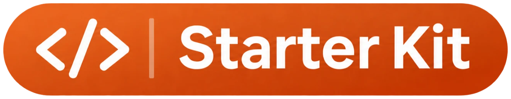
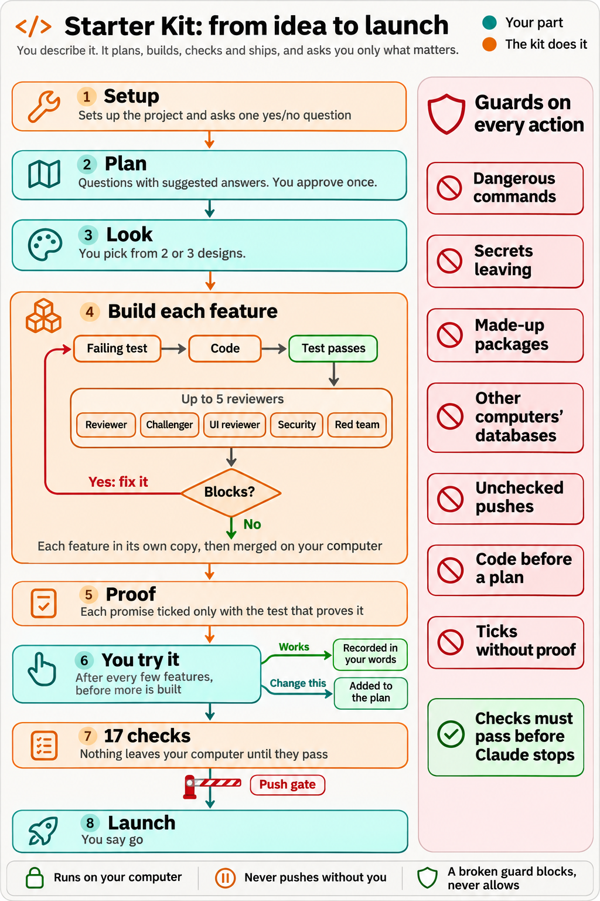

<p align="center">
  
</p>

<p align="center">
  <b>A Claude Code plugin that plans, builds, tests, reviews and ships software for you, safely.</b><br>
  Any language, any kind of project. Made for people who don't code, and useful for people who do.
</p>

<p align="center">
  <a href="https://github.com/ColeDonMedia/claude-code-starter-kit/actions/workflows/tests.yml"></a></p>

<p align="center">
  <a href="#install">Install</a> ·
  <a href="#how-you-use-it">How you use it</a> ·
  <a href="#every-step-from-idea-to-launch">Every step</a> ·
  <a href="docs/example.md">See an example</a> ·
  <a href="#how-it-saves-tokens-without-cutting-corners">Saving tokens</a> ·
  <a href="#which-model-and-thinking-level-to-use">Model and effort</a> ·
  <a href="#whats-inside">What's inside</a> ·
  <a href="#protection-built-in">Protection</a> ·
  <a href="docs/README.md">Full documentation</a>
</p>

---

## What it does

- **Runs the right workflow by itself.** You describe what you want in plain words; Claude picks the plan, build, test, review or
  ship workflow and says in one line what it ran. You never type a command.
- **Plans before it builds.** A new app gets researched, sized, designed and broken into a checklist you approve once.
- **Builds test-first, in isolation.** Each feature is built in its own branch and its own fresh context, reviewed separately, and
  merged only when the tests pass, so your chat stays small.
- **Guards your computer and secrets.** Dangerous commands, leaked keys, fake packages and unchecked pushes are stopped, and its
  own security checks need nothing installed.
- **Checks every screen like an agency would.** A way back from every page, an X on every popup, search on long lists, no
  duplicate or wrapping buttons: measured in a real browser and checked by eye.
- **Reviews in proportion.** Only problems that break what you agreed, or let a stranger in, hold a feature back; the rest is
  listed to fix before launch.
- **Remembers where it left off.** Say "continue" to resume from the last verified step.

## Install

Once per computer:

```
claude plugin marketplace add ColeDonMedia/claude-code-starter-kit@stable
claude plugin install starter-kit@starter-kit-marketplace
```

Restart Claude Code. The kit then updates itself daily, only to versions that passed their tests.

<details>
<summary>Install trouble?</summary>

- Inside Claude Code, the same commands are `/plugin marketplace add …` and `/plugin install …`.
- If the `owner/repo` form fails because SSH isn't set up, use
  `https://github.com/ColeDonMedia/claude-code-starter-kit.git#stable` instead.
- Update by hand: `claude plugin marketplace update starter-kit-marketplace`.
</details>

## How you use it

Open a project folder in Claude Code and talk normally.

| You say | What happens |
|---|---|
| *(open a project that isn't set up)* | It sets the project up and asks you one question: how much to ask before running things. |
| "Build me an app that…" | A researched plan and roadmap. You approve it once; it builds feature by feature. |
| "Add a…" / "Fix the…" | The feature is built test-first in its own branch, reviewed, and merged when green. |
| "This error keeps happening" | It finds the cause with evidence and adds a test so it stays fixed. |
| "Continue" | It carries on with the next roadmap item, or resumes one that was cut off. |
| "Where are we?" | Progress, what's next, what it needs from you. |
| "Ship it" | The full pre-ship scan runs; pushes wait until it passes. |

See [a whole example build](docs/example.md), with the files it adds, usage and switching it off. More in
[How it works](docs/how-it-works.md).

## Every step, from idea to launch

<p align="center"></p>

This is the whole path a new app takes. Each stage runs by itself; you're only asked where your answer changes the result.
[Every step in full detail](docs/every-step.md) covers what you see, what Claude does, which files change and what can stop it.

**1. Every session starts with a briefing.** Before you type, a short note tells Claude which workflow fits which request, that
you're not a programmer, how far the roadmap is, what's waiting for you, and whether a build was cut off. The first session after an
update proves the guards are running. Updates install themselves once a day, only versions that passed their tests.

**2. Setup** (first time in a folder, even an empty one):
- works out how to install, run, test and build the project, and makes it a git project if it isn't one (nothing is uploaded)
- writes `CLAUDE.md` (the project's rulebook for Claude), locks your keys and login files away from Claude, and adds a git hook that
  refuses secrets in any commit
- for anything with a screen, sets up real-browser tests at phone and desktop size, plus speed, accessibility and screen checks
- starts the project's memory: `PROJECT.md`, `HANDOFF.md`, `CHANGELOG.md`
- asks you **one question**: may it run the project's own checks automatically?

**3. The plan** (new apps; a hook refuses app code until it exists):
- one message of questions, each with a suggested answer, always including how many people will use it
- researchers look at 4 to 6 similar products and, for an app meant to sell, **the market**: demand, who would buy it, how crowded
  it is, and a gap competitors would find hard to copy. The plan gives a verdict (build it, build it narrower, pivot, or think again),
  recommends gap features and, if it is crowded, less crowded directions, with sources. **Every citation is checked by a script**:
  it opens the page and confirms the quoted words are really there, so an invented source or a wrong price is dropped
- **what it will cost to run**, for anything hosted, sold in a store or using paid services: every cost from the domain to text
  messages, priced from the providers' own pages and checked by a script, with the minimum to begin, the recommended setup, what to
  invest, the bill at each size and when to upgrade each plan (see [What it will cost to run](#what-it-will-cost-to-run) below)
- the stack: a **recommended stack plus one or two alternatives, each with plain pros and cons**. Approving the plan keeps the
  recommendation; you can pick another or name your own (any language). For common kinds of app the recommendation is a **tested
  recipe** (see [Stack recipes](#stack-recipes) below)
- **numbers and rules, defined once**: every number the app shows or decides by (monthly income, totals, "active customer") gets one
  plain definition you approve, so it means the same on every page
- a gap check (empty and error screens, password reset, deleting data, phones, keyboard use) and a threat check (who could misuse it,
  and a test for each defence)
- a plan with testable criteria, a roadmap in milestones of about three features, a speed budget and a screen list
- a second agent attacks the plan before you see it; **you approve once**
- **already half-built?** It doesn't start over: it maps what's there, proves what works (that becomes milestone 0, which you
  confirm), lists what's broken or untested, and plans only what's left

**4. The look.** Two or three directions from the style library (89 styles, 194 palettes, 74 font pairings), shown side by side for
you to pick. The choice becomes `DESIGN.md`, which every screen follows.

**5. Each feature, in its own fresh context:**
- a **conductor** agent runs the whole build away from your chat; the build's progress is recorded so a cut-off resumes where it stopped
- a **builder** works in its own copy of the project, on its own branch, **test first**: one failing test per agreed criterion, then
  the code, committing after every passing test
- before writing anything new it asks **"does this already exist, and does it do what this feature needs?"** It reuses it, or
  extends that one function, and never writes a second version beside it. A copy-check finds code it wrote twice before review does
- when it isn't sure how a library works, it reads **the installed copy first** (exact version, free), then the official docs, never memory
- for screens it builds every state, measures each one in a real browser at phone and desktop size, and re-runs with extreme data (the
  longest name, 300 items, a missing picture)
- a **reviewer**, a **challenger** (who assumes it's not done), a **UI reviewer** and, for risky features, a **security reviewer** and a
  **red team** check it in parallel
- only problems that break what you agreed or let a stranger in go back for a fix; the rest is listed to fix before launch
- from round 3 a script decides if more rounds are worth it; round 6 always comes to you
- it's merged only when everything passes, the roadmap is ticked **only with the test that proves each criterion**, the records are
  updated, and you get a short report: what works, how to see it, and what it used

**6. A checkpoint every three features.** All tests, every roadmap tick, the records and the approved plan are checked against what
was really built.

**7. You try each milestone before more is built.** A first-time-user agent walks it in a browser first, every screen is compared with
every other, and accessibility is checked by hand. Then you get five to eight things to try. Your verdict is recorded in your own words,
and changes you ask for become roadmap items.

**8. Nothing leaves without the pre-ship scan.** Seventeen checks: tests, types, lint, build, dependency and configuration scanners, a
security review, browser tests, your acceptance, database changes, records, speed, design, load and accessibility. A hook blocks every
push and deploy until that exact commit has passed. **[All seventeen, with what makes each one block a push](docs/every-step.md#8-before-anything-leaves-your-computer-full-scan).**

**9. The first launch.** Separate test and live copies, payments in test mode first, automatic deploys, error and uptime alerts,
a backup that has actually been restored, a practised rollback, HTTPS and security headers, the cost check re-run on today's prices
with a spending alert on every paid service, and a `RUNBOOK.md`.
It asks for your go-ahead before going live.

**10. After launch.** A monthly check-up (updates, security, backups, speed, costs), outage handling that restores service first, and
speed work that's measured before and after.

**All the way through, guards watch every command and edit:** dangerous commands, leaked secrets, invented packages, remote databases,
unchecked pushes, code before a plan, and roadmap ticks without proof. When Claude finishes a turn with changed code, the project's own
checks run, and the turn can't end while one fails.

## Stack recipes

Opus already knows HTML, CSS, JavaScript, SQL and the big frameworks well, so loading their general docs into every session would cost
tokens and add little. What a model gets wrong is **what changed since it was trained**. When the recipes were built, three of the
four official setup tools behaved differently from what a model would guess: a renamed template, a TypeScript upgrade that rejected the
starter's settings, and example code that failed its own lint check. The kit handles that in three ways:

| | What it is | When it's used |
|---|---|---|
| **Recipes** | Four tested starting points: a website (Astro), a web app with sign-in and a database (SvelteKit, SQLite, Better Auth), an API (Fastify, SQLite) and a desktop app (Electron Forge). Each has the official setup command at a pinned version, exact package versions, the commands, the host, the accounts and settings you'll need, and the stack's known mistakes. | Recommended in the plan when one fits the app's kind and size; you can always choose something else. |
| **Stack notes** | The recipe's known mistakes and where its docs are, written to `.claude/rules/stack.md`, which Claude Code reads in every session. | From the first feature on; updated when a major version changes. |
| **Installed docs first** | The library's own types, README and changelog in the project, which match the exact version and cost nothing to read. | Whenever the builder isn't sure of an API, in every project, recipe or not. |
| **Stack guidelines** | The most important do's and don'ts for 23 frameworks (Laravel, Next.js, Svelte, Flutter, SwiftUI, WPF and more), each with its official docs link, from a vetted open-source design project. Up to 25 per stack, one file each in `.claude/rules/`, loaded only while Claude works on that stack's files, so they cost nothing otherwise. Front-end and screen rules only. | Any project whose files show one of those stacks, recipe or not; refreshed after major updates. |

Every recipe is set up from scratch and must pass its own tests, type checks, lint and build in the kit's own test, run whenever a recipe
changes; each recipe records the date it last passed.
Deploying to a host is set up at launch and is not part of that test.

## What it will cost to run

Before anything is built, the plan tells you what the app will cost: to start, to run at the size you expect, and at every size after
that. A model's memory of prices is months old and often wrong, so **no price in this check comes from memory and no total is worked out
by the model.**

**How the prices are found**
- Researchers (on Sonnet, because a wrong price costs money) compare two or three real options for each need. For hosting that might be
  a server host (such as DigitalOcean or AWS), a platform host (such as Vercel) and a serverless host (such as Cloudflare), chosen to fit
  the stack and the size.
- Every price is quoted from **the provider's own pricing page**, or from its official machine-readable price list where one exists
  (AWS and Azure publish theirs without a key).
- A script opens each page and confirms **the quoted words are on it**. A second check confirms **the price used is the number in
  the quote**, so a misremembered "$6" can't become "$5". A page that shows prices only after scripts run is marked "checked by hand".

**Every line, including the gritty ones**

| Area | What's counted |
|---|---|
| Domain | first-year price **and renewal price** (often higher), privacy for your details, DNS, premium names; https certificates (usually free) |
| Hosting | the plan's memory, CPU, requests and build minutes; team seats; extra regions; the hidden lines: data sent to users, load balancers, public IP addresses, NAT gateways, logs, snapshots |
| Database | the plan, storage, backups and point-in-time restore, connection limits, a standby copy when downtime costs money |
| Files | storage, requests per thousand, data sent out, a CDN for heavy pages |
| Email | sign-up, reset, receipts and notifications counted per user; marketing email apart; a business inbox if you need one |
| Texts | price per message in each country, phone-number rental, carrier registration fees (US business texting), sign-in code services |
| Sign-in, AI and APIs | price per active user; per million AI tokens in and out; maps, search and other APIs; free credits, **when they run out, and the bill after** |
| Payments | card percentage and fixed fee, international and currency fees, disputes, subscription and tax add-ons, and the merchant-of-record alternative that handles sales tax for you |
| Running it | error tracking, uptime checks, log retention, off-site backups |
| Stores and signing | app-store developer accounts, desktop code-signing certificates |
| Tools | paid plans for the code host, CI minutes past the free amount |
| Not counted | taxes, company registration, an accountant, insurance and your own time. The plan says so plainly. |

**What you get**, worked out by the kit's own calculator from those prices and the plan's size (`.claude/costs.json`, so it can be
re-run at any time):
- **Minimum to begin:** the smallest plans that work for your first users, a month.
- **Recommended:** the plans that fit the size you expect, with the same headroom the load test uses, and why. Payment fees are shown
  apart, because they come out of what customers pay.
- **To invest:** what's paid once (store accounts, certificates), and the first year in total at both sizes.
- **At each size:** the monthly bill and the cost per user, from your first users to ten times the expected size, with every
  alternative priced side by side, so you see where one host gets cheaper than another.
- **When to upgrade:** "at about 2,500 users, move the database to the next plan: $45 more a month". Usage grows with users, so these
  are exact counts, not guesses.
- **Break-even:** when what users pay covers the bill, if the app is sold.
- **Free-tier limits** and what happens at each one (the service stops, or starts charging), the **costs that can grow faster than
  users** (texts, AI, data sent out) in the risk list, and the **date the prices were checked**.

It is an estimate from today's public prices, never a quote, and the plan says so. At launch the check runs again on fresh prices,
anything older than 30 days is re-checked, and a spending alert is set on every paid service. The monthly check-up compares the real
bill with the estimate, updates usage from real numbers, and tells you how close the next upgrade point is.

## How it saves tokens without cutting corners

Getting it right once costs less than fixing it again and again, so most of the saving comes from **not redoing work**. The checks
themselves are never skipped to save tokens.

**It doesn't redo work:**
- **One approved plan first.** Questions, research, gap and threat checks happen once, before any code, and every criterion becomes
  a test. Most rework comes from building the wrong thing, and this is where that's caught.
- **Tested recipes** mean setup isn't worked out (and debugged) again for every project.
- **One source for each number and rule.** A number computed once can't drift apart on six pages and need six fixes.
- **Only real problems cause a fix round.** Reviewers mark each finding BLOCKS (breaks what you agreed, or lets a stranger in) or LATER.
  Only BLOCKS go back to the builder; LATER items wait in a "before launch" list instead of starting new rounds.
- **A stop rule.** From review round 3, a script (which costs no tokens) checks whether another round is still making progress;
  round 6 always comes to you.

**It reads less:**
- **Each feature runs in its own fresh context.** Your chat gets a twelve-line result, not the whole build, so it stays small and
  cheap for the whole project.
- **Records instead of re-reading.** `PROJECT.md`, `HANDOFF.md` and the roadmap tell each new session where things stand. The
  session note stays under 520 words.
- **A code index** finds where something lives and what a change could break, without reading the whole codebase.
- **Long output is shortened.** A test run or install that prints thousands of lines reaches Claude as the start, every failure and
  the summary. The full log is saved, and the command and its result are unchanged.
- **Installed docs before web searches**, and only the related tests while a big codebase is being built (the full suite still runs
  before anything ships).

**It uses the right model for each job:**
- Haiku only finds files and searches the web, and its findings are checked by a stronger model.
- Sonnet builds small, contained features and re-checks a fix (it looks only at its own earlier findings and the changed lines).
- Opus builds medium, large and risky features and runs every security review. Its share is recorded per feature.

**What is never cut:** test-first building, the reviewer and challenger on every feature, the security reviewer and red team on risky
ones, your try-out at every milestone, and all seventeen pre-ship checks. Every merge report says what the feature used.

**What isn't proven yet:** the savings from 2.18 onward haven't been measured in a live build. The last live trial (on 2.17.2) spent
84% of its agent tokens on Opus, mostly on review re-checks. That is why re-checks now run on Sonnet.

## Which model and thinking level to use

The kit picks the model for every agent it starts (builder, reviewers, testers) by itself, by the size and risk of the job. What you
choose is only the model and **effort** (thinking level, `/effort`) of your own conversation with Claude, where planning and the
decisions happen. These are the kit's recommendations, not Anthropic's rules:

| Situation | Model | Effort | Why |
|---|---|---|---|
| **Starting out, everyday use** | Opus 5.5 (the default) | medium (the default) | Strong enough to plan and judge; the kit sends the heavy work to its own agents. |
| Planning a new app, a big change, or a hard decision | Opus 5.5 | high | One good plan saves many fix rounds. Switch back afterwards. |
| A smaller plan or a tight usage limit | Sonnet 5.5 | medium | Noticeably cheaper; the kit still reviews everything on the models it needs. |
| The hardest planning (a big product, a tricky architecture), occasionally | Fable 5.2 | high | The most capable and the most expensive. The kit never picks it by itself; use it for that one conversation. |

Avoid `max` effort for everyday work: Anthropic's documentation warns it can overthink and show diminishing returns.

### Ultracode

**Ultracode** is a Claude Code setting (`/effort ultracode`; off again with `/effort ultracode off`), not a model. With it on,
Claude turns every substantive request into a *dynamic workflow*: a script that runs many subagents in parallel. Anthropic says
workflows "can consume substantially more tokens than a typical Claude Code session", so you reach usage limits sooner.

**With this kit, leave it off for normal building.** The kit already runs its own parallel agents (a fresh context per feature, up to
five reviewers at once, the testers), with its own model choices, review rules and proof steps. A workflow starts its agents another
way, so it can build outside that process, and it costs far more. Ultracode and the kit have not been tried together in a live build.

**When it is worth it:** a one-off job that is very wide rather than deep: mapping a huge unfamiliar codebase, a search for one bug
across hundreds of files, a large mechanical migration, or research that needs many sources cross-checked. Turn it on for that
task, then turn it off again. You can also ask for a single workflow ("run this as a workflow") without changing the setting.

Sources: [Introducing dynamic workflows in Claude Code](https://claude.com/blog/introducing-dynamic-workflows-in-claude-code),
[Workflows](https://code.claude.com/docs/en/workflows) and [Model configuration](https://code.claude.com/docs/en/model-config) in
the Claude Code docs.

## What's inside

Every workflow and agent opens with the same strict **Scope**: its job, when it starts, what it may do, what it must not do, when
it's done, and what it hands back. A test makes sure none is missing or vague, so no stage can drift into another's work.

### 21 workflows

Claude starts these itself; you can also type them.

| Stage | Workflow | What it does |
|---|---|---|
| **Plan** | `/starter-kit:init` | Sets up a project: detects the stack, writes its `CLAUDE.md` |
| | `/starter-kit:spec` | Turns an idea into an approved plan and roadmap |
| | `/starter-kit:research` | Competitors and the market, every claim linked |
| | `/starter-kit:design` | Picks a look from the style library and checks accessibility |
| | `/starter-kit:onboard` | Maps a big existing codebase, area by area |
| | `/starter-kit:vet` | Checks someone else's add-on before you install it |
| **Build** | `/starter-kit:feature` | Builds a feature test-first in its own branch, reviews it, merges it |
| | `/starter-kit:tdd` | One small test-first fix in the current conversation |
| | `/starter-kit:debug` | Finds a bug's root cause with evidence, then fixes it; handles a live outage |
| | `/starter-kit:db` | Database changes on a local copy, rehearsed at real size |
| **Check** | `/starter-kit:review` | Reviews changes made in the conversation |
| | `/starter-kit:audit` | Security audit of the whole project |
| | `/starter-kit:redteam` | Attacks a local copy like a hostile user |
| | `/starter-kit:speed` | Measures what's slow and fixes the biggest cause |
| | `/starter-kit:accept` | You try the finished milestone; your verdict is recorded |
| | `/starter-kit:dogfood` | Checks what the kit itself did after a trial build |
| **Ship and run** | `/starter-kit:full-scan` | The pre-ship sweep: every test, build and security review |
| | `/starter-kit:launch` | The first go-live: environments, backups, alerts, a runbook |
| | `/starter-kit:legal` | Privacy policy, terms and library licenses |
| | `/starter-kit:maintain` | The monthly check-up |
| | `/starter-kit:status` | Where things stand, in plain words |

### 11 agents

| Agent | Model | Job |
|---|---|---|
| `conductor` | Sonnet; Opus for large or risky features | Runs one feature's whole build in a fresh context |
| `implementer` | Sonnet; Opus for medium, large or risky features | Builds one feature in its own branch and folder |
| `scout` | Haiku | In big projects, finds the files and lines a job needs |
| `researcher` | Haiku | Researches the web, returns a sourced report |
| `reviewer` | Opus | Reviews correctness and runs the tests (read-only) |
| `ui-reviewer` | Sonnet | Looks at the running app at phone and desktop size; goes through the UI checklist (read-only) |
| `security-reviewer` | Opus | Hardening review of risky features and before shipping (read-only) |
| `challenger` | Sonnet; Opus for plans and large features | Tries to prove the work isn't done; checks the plan (read-only) |
| `investigator` | Sonnet; Opus once a first guess fails | Finds a bug's root cause outside the main conversation (read-only) |
| `red-team` | Opus | Attacks a local copy like a hostile user, writes a test for every break |
| `user-tester` | Sonnet | Tries each finished milestone like a first-time user, before you do |

How models are picked: [which model does what](docs/how-it-works.md#which-model-does-what).

## Protection built in

| Guard | Stops |
|---|---|
| Safety guard | Commands that wipe drives or history, in Bash and PowerShell; asks before risky ones, and before deleting code, moving it out of the project or overwriting a code file |
| Snapshots | Before every risky command, the work as it is (unsaved files included), a copy of a local database file and a dump of a local Postgres or MySQL database are saved on your computer, so a wrong "yes" can be undone |
| Secret guard | Keys, `.env` files and your private terms leaving in a commit, push or deploy |
| Package guard | Installing packages that don't exist (invented names attackers register) |
| Push gate | Pushes and deploys before the pre-ship scan passes for that exact commit |
| Database guard | Connecting to any database that isn't on your computer |
| Model check | A review started on a weaker model than its job needs |
| File and web guards | Claude reading your key files, or keys leaving in a web address; warns about injected orders in pages |
| Built-in scanners | Known flaws and malware in dependencies, unsafe workflows, Dockerfiles and Compose files, missing headers |

The guards prove they are running, a crashed guard refuses the command, and a project can't switch them off without your approval.
Details: [Safety and security](docs/safety.md).

## What still needs you

- Creating accounts and paying for services (hosting, domains, payment providers).
- Approving the plan, trying each milestone, and saying "ship it".
- A lawyer's review of the legal drafts, and a professional security test for apps that hold payments or sensitive data.

## What's proven and what isn't

- **Proven:** over 570 automated tests over the hooks and scripts, including hundreds of disguised attacks thrown at the guards. Every push runs them on Windows, macOS and Linux.
- **Not yet proven:** a full real-world build from idea to launch. A [trial](docs/trials.md) has built a real app's first milestone
  (three features, accepted by its owner) on Windows; what it found is fixed, but those fixes haven't run in a live build yet. Found a problem? [Open an issue](https://github.com/ColeDonMedia/claude-code-starter-kit/issues).

## Requirements

- A current Claude Code (very old versions fail with "tool_use ids must be unique"). It runs on your own Claude plan: no API key.
- Node.js 18 or newer, and git. Database features need Node 22.5 or newer.

## Documentation

[Every step, in full](docs/every-step.md), [What using it looks like](docs/example.md), [How it works](docs/how-it-works.md), [Safety and security](docs/safety.md),
[Quality and testing](docs/quality.md), [Planning, records and memory](docs/planning-and-records.md),
[Design and accessibility](docs/design-and-accessibility.md), [Speed and scale](docs/speed-and-scale.md),
[Databases](docs/databases.md), [Big codebases](docs/big-codebases.md), [Launch, operations and legal](docs/launch-and-operations.md),
[Add-ons and vetting](docs/add-ons.md), [Settings](docs/settings.md), [Changelog](CHANGELOG.md).

## Contributing

> **Public repository:** no names, emails, client details, personal file paths, keys, tokens or private code.

Run the tests before every change:

```
node --test plugins/starter-kit/hooks/*.test.mjs plugins/starter-kit/scripts/*.test.mjs
```

## License

MIT. See [LICENSE](LICENSE). The design data in `plugins/starter-kit/library/ui-ux-pro-max/` is MIT-licensed and keeps its
own license file; no other project's code is copied here ([vetting record](docs/vetted.md)).
