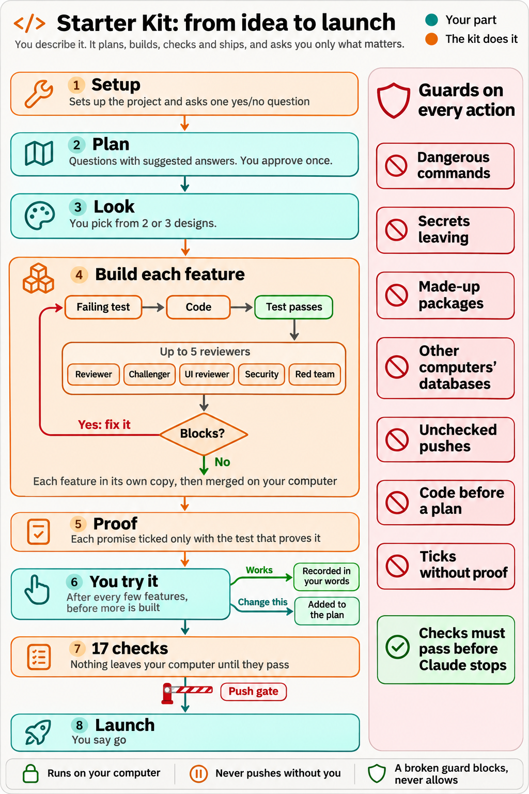

# Every step, from idea to launch

[← Back to the README](../README.md) · [All documentation](README.md)

This page follows one project from the first message to a live app and lists everything the kit does along the way, in the order
it happens. Each stage says what you see, what Claude does, what runs automatically, what files change, and what could stop it.

You never type a command. Claude picks each workflow from what you say and tells you in one line what it ran. The command names
(`/starter-kit:spec` and so on) are shown here so you can find the files behind each step.

**The stages:**

1. [Every session starts with a briefing](#1-every-session-starts-with-a-briefing)
2. [Setting up a project](#2-setting-up-a-project-init)
3. [Planning the app](#3-planning-the-app-spec)
4. [Choosing the look](#4-choosing-the-look-design)
5. [Building one feature](#5-building-one-feature-feature)
6. [Checkpoints every three features](#6-checkpoints-every-three-features)
7. [Trying a finished milestone](#7-trying-a-finished-milestone-accept)
8. [Before anything leaves your computer](#8-before-anything-leaves-your-computer-full-scan)
9. [Going live for the first time](#9-going-live-for-the-first-time-launch)
10. [After launch](#10-after-launch-maintain-debug-speed)
11. [What runs on every action, at every stage](#11-what-runs-on-every-action-at-every-stage)
12. [The other workflows](#12-the-other-workflows)
13. [When things go wrong](#13-when-things-go-wrong)

---

## 1. Every session starts with a briefing

**When:** every time you open Claude Code in a folder, and again after a chat compacts (summarises itself).

**What you see:** usually nothing, or one line. Claude simply knows where things stand.

**What happens:**
- **A session note is added to Claude's context** (under 520 words). It tells Claude:
  - which workflow to run for which kind of request (this is how you never need to type a command)
  - that you are not a programmer, so results come in plain words and routine technical choices are Claude's to make
  - the "lean" working rules: lead with the answer, read files narrowly, make the smallest change
  - how far the roadmap is, what is being built right now, and what is next
  - anything waiting for you (a question, a milestone to try)
- **The guards prove they are running.** The first session after each update asks Claude to run a harmless test command
  (`starter-kit-canary`) with every shell tool; the guard must refuse it. If it isn't refused, Claude tells you before anything else.
- **The kit checks for updates** in the background, at most once a day, from the `stable` channel (only versions that passed their
  tests on Windows, macOS and Linux). A new version takes effect the next session.
- **A large old chat is flagged.** Every message re-sends the whole conversation, so reopening a huge chat costs a lot. The kit says
  so and suggests a new chat; the project's records carry everything over.
- **A cut-off build is noticed.** If a feature was halfway through when the last session ended, the note says where it stopped.

**Files involved:** none are changed. The note is read from the plugin and from your project's records.

---

## 2. Setting up a project (`init`)

**When:** you open a folder the kit hasn't set up, even an empty one. Claude runs this by itself, without asking.

**What you see:** a few lines saying what kind of project this is and what was set up, and **one yes/no question**: may it run the
project's own tests and checks without asking each time.

**What Claude does, in order:**
1. **Works out the project's tools** by reading its files (`package.json`, `pyproject.toml`, `go.mod`, `Cargo.toml` and the like):
   how to install, run, test, check types, lint and build. An empty folder is fine; the plan chooses these later.
2. **Makes it a git project** if it isn't one: a local history, a `.gitignore` and a first commit. Nothing is uploaded. If git has no
   author, it uses your GitHub username and GitHub's private no-reply address, never a personal email and never a made-up name.
3. **Writes `CLAUDE.md`**, the project's rulebook for Claude: the commands, the test-first rule, the conventions, the records to keep,
   and "never push unless asked". An existing `CLAUDE.md` is never overwritten; missing sections are added at the end.
4. **Locks away secrets.** It adds rules so Claude cannot read `.env` files, key files, or the credential files in your home folder
   (SSH, cloud and GitHub logins, password files), and makes git ignore secret files.
5. **Sets long chats to compact sooner** (at 300,000 tokens instead of near a million), so each message stops re-sending a huge history.
6. **Asks the one question**, listing the exact commands. On yes, Claude Code shows you a permission prompt with those commands: that
   prompt is your real approval. On no, the project still works; only the automatic checks stay off.
7. **Guards every commit**, whoever makes it: a git pre-commit hook that refuses keys, `.env` files and the private terms you list
   (your name, email, client names).
8. **Adds checks on GitHub** if the project uses GitHub: a workflow that runs the tests, a dependency audit and the secret scan on every
   push, using only official GitHub actions pinned to exact versions, with read-only permissions.
9. **For anything with a screen**, sets up real-browser testing (Playwright) at phone and desktop sizes, after checking there is disk
   space for the browser. It adds a first test (the home page loads with no errors), a speed test, an accessibility test, and the UI
   checkpoint that measures every screen.
10. **Asks the size question** if it can tell what the project is: on your computer or online, how many people, how many at once, and
    what an hour of downtime costs. The answer decides how the app is built.
11. **Starts the project's memory:** `PROJECT.md` (the master document), `HANDOFF.md` (where things stand for the next session) and
    `CHANGELOG.md`.
12. **Commits the new files locally**, then carries on with what you asked. A new app goes straight to planning.

**What could stop it:** a secret file already in git history. Claude stops and tells you in one sentence that the key must be replaced
(deleting the file does not remove it from history).

---

## 3. Planning the app (`spec`)

**When:** you describe a new app, or a big or vague feature. In a project the kit started from an empty folder, **a hook refuses to
write app code until a plan exists**, so this step can't be skipped.

**What you see:** one message of questions, each with a suggested answer (say "yes" to take them all); then one plan to approve or
correct.

**What Claude does, in order:**
1. **Looks before asking.** It reads what is already there so it doesn't ask what it can see.
2. **Asks once, at most six questions, each with a default:** who it's for, the one thing it must do well, must-haves versus later,
   phone or computer, whether people sign in, what it must connect to, budget or deadline, apps whose look you like. Always one question
   about size. It never asks you to choose technology. A small app gets at most four questions and a one-screen plan.
3. **Sizes it.** Your answers become numbers: requests per second at the busiest moment, table sizes after a year. It then knows what to
   build and what to leave out (a one-person desktop app gets no servers; a busy online service gets them from the start).
4. **Researches** (new apps): two or three researcher agents, on the cheap fast model, look at 4 to 6 similar products in parallel: what
   they all have, and what their users complain about. Claude checks their claims and re-checks prices, legal rules and security advice on
   a stronger model.
5. **Chooses the technology:** widely used, well documented, cheap to host. Current versions are checked from official sources, never from
   memory. It also checks what this computer can actually run, so every promise can be proven here; anything only GitHub can prove (such as
   a container build) is named as such.
6. **Compares with existing code** (if any): what already works, what's partly there, what's missing.
7. **Checks for gaps:** empty, loading, error and offline screens; sign-up and password reset; deleting and exporting data; small screens and
   slow connections; keyboard use and contrast; what the owner needs to see errors.
8. **Thinks like an attacker:** what is worth protecting, who could misuse it, the likely attacks and the defence for each. Each defence
   becomes a test ("user A asking for user B's record is refused"). Risky features (sign-in, payments, uploads, other people's data) are
   marked for extra review.
9. **Picks a look** with you (stage 4).
10. **Writes the plan:** the goal, how it works for the user, the technology, acceptance criteria (each one a test), security, how you'll
    know it worked, the roadmap (3 to 10 features in milestones of about three, each sized S, M or L), size, the speed budget, every screen
    and how many items its lists will hold after a year, how success will be measured, which rules apply (personal data, children,
    payments, AI), the top five risks, what is left for later, and every default it picked.
11. **Has the plan challenged** by a second agent that looks for holes before you see it. You only get the choices that are really yours.
12. **Waits for your approval.** Nothing is built until you approve.
13. **Saves it** as `ROADMAP.md` (milestones with `Accepted: pending`, features with their criteria as checkboxes), `PROJECT.md`,
    `DECISIONS.md` (one numbered line per decision, with the reason and what was rejected), and `.claude/ui.json` (the screen list).
14. **Starts building**, one feature at a time, without being asked again.

**Changing your mind later** is normal. Before building anything that wasn't in the plan, Claude says what it adds or delays and what it
recommends, then updates the roadmap and records the decision. It never quietly adds scope or drops an agreed feature.

---

## 4. Choosing the look (`design`)

**When:** during planning for anything with a screen, or when you say it looks plain, generic or off.

**What you see:** a page with two or three design directions side by side (colours, fonts, buttons). You pick one, or say what to change.

**What Claude does:**
1. Looks at the apps you named and notes what each does well (spacing, density, type, colour, motion).
2. Searches the kit's style library (89 styles, 194 contrast-checked colour palettes, 74 font pairings) for directions that fit your product
   and your references.
3. Shows them side by side. It never picks for you when you can see the options.
4. Writes `DESIGN.md` (feel, colours, type, spacing, components, accessibility, references, quality bar) and checks it: unreadable colour
   contrast fails.
5. Measures accessibility (WCAG 2.2 AA) and walks the checks a person must do: keyboard only, 200% zoom, 320 pixels wide, reduced motion.

Every later screen follows `DESIGN.md`, and the UI reviewer scores each screen against it. Details: [Design and accessibility](design-and-accessibility.md).

---

## 5. Building one feature (`feature`)

**When:** after the plan is approved, for each roadmap item in order; or when you ask for a feature or a real bug fix.

**What you see:** nothing until it's done, then a short report: what now works, how to see it, anything left as is, and a progress line
("2 of 9 features done (25% by size); 7 of 30 criteria proven; this feature used 410K tokens in 7 agent runs (30% on Opus)").

**Why it's done this way:** every message in a chat re-sends the whole conversation, so a chat that builds twenty features gets slower and
costlier with each one. Each feature is built in its own fresh context instead, and your chat only gets the result.

### 5a. Before it starts
- Claude checks there is a git project with a first commit, that nothing unsaved is lying around, that a plan exists, and that the project
  is set up.
- It records the build's state **outside your project**: the feature, its stage, its branch and the last commit whose tests passed. If the
  session ends, a usage limit hits or the computer turns off, "continue" resumes from there.
- It hands the feature to a **conductor** agent, which runs the whole build in its own context. Only the conductor may start the builder
  and reviewers (a hook enforces this).

### 5b. Picking the models
Before each agent starts, a script picks its model from facts the project already records:
- **Builder:** Sonnet; Opus when the feature is medium or large, risky (sign-in, payments, uploads, personal data), touches code that 10 or
  more files depend on, or two review rounds have failed.
- **Reviewer:** Opus, and never weaker than the builder. **Security reviewer and red team:** always Opus.
- **Challenger and UI reviewer:** Sonnet (challenger on Opus for large features).
- **Re-checks after a fix:** Sonnet, except the security reviewer.
- A hook refuses to start a review on a weaker model than its job needs.

Details: [Which model does what](how-it-works.md#which-model-does-what).

### 5c. The builder works in its own copy
- In a big project, a **scout** (the cheap fast model) first points at the exact files and lines the job needs. A script checks every
  pointer before it's used.
- A **context pack** is pulled from the project's records: the roadmap item, the latest decisions, the relevant part of the code map, and
  the design brief. A big project doesn't mean a big brief.
- The **implementer** gets its own **worktree** (a second folder) on its own **branch**, so your main copy is never touched while it works.
- It installs dependencies there, then builds **test first**: a failing test for each acceptance criterion, confirmed to fail for the right
  reason, then the least code that passes, then a tidy-up. It never weakens or deletes a test to make it pass.
- It never guesses a library's API from memory; it looks up the current documentation.
- **Secure by default:** every action checks who is asking and whether they may touch this record; input is validated on the server;
  queries are parameterised; secrets come only from environment variables; passwords are hashed with a vetted library; sign-in is
  rate-limited; uploads are limited and stored privately; payment prices are computed on the server and webhooks are verified.
- **Fast by default:** no database query inside a loop, every list is paged and indexed, a test proves the number of queries doesn't grow
  with the number of rows, slow work goes to a background job, every tap shows a response at once.
- **For screens:** it follows `DESIGN.md`, builds every state (empty, loading, error, success), works at phone and desktop width, meets
  WCAG 2.2 AA, and goes through the **UI checklist** for the screen's parts (lists, popups, forms, menus). Browser tests click through the
  real app at both sizes and call `checkpoint()` at every state, which saves a screenshot and measures the screen: a way back, an X on every
  popup, Escape closes it, no duplicate or wrapping buttons, search on long lists. Then it runs everything again with **stress data**: the
  longest name, a long unbroken word, 0, 1 and 300 items, a huge number, a missing picture.
- New packages are checked to exist and be established before they are added (the package guard also stops invented names).
- It changes files with small edits rather than rewriting them, and **commits after every passing test**, so a cut-off loses minutes.
- It runs the full test suite, type checks and lint; all must pass.
- It reports back: the branch and folder, a table mapping **each acceptance criterion to the test that proves it** (or "NOT DONE"), new
  settings and services, and exactly what personal data goes where.

### 5d. The review
All of these read the change in parallel, each in its own fresh context, running every command inside the builder's folder:
- **Reviewer** (always): correctness, edge cases, regressions. Runs the tests.
- **Challenger** (always): assumes the work is NOT done and tries to prove it: claims without evidence, tests that couldn't fail, missing
  cases, collateral damage. It must show what it tried.
- **UI reviewer** (when screens changed): opens the running app at phone and desktop size, scores it against `DESIGN.md`, reads the measured
  results and goes through the UI checklist by eye.
- **Security reviewer** (risky features, or a change touching sign-in, permissions, payments, uploads, database rules, secrets or network
  settings): a hardening review now, not only before shipping.
- **Red team** (risky features, once): attacks a local copy like a hostile user. Every break comes with a failing test that stays in the
  project for good.

**Every finding is BLOCKS or LATER.** BLOCKS means it breaks an agreed criterion or a named threat, or lets an outsider reach someone
else's data or account. Only those go back to the builder. LATER findings are written under "Harden before launch" in `PROJECT.md` and
checked before launch.

### 5e. Fix rounds, and when to stop
- BLOCKS findings go back to the **same builder** in the same folder.
- The second look reads **only the fix**, and only the reviewers that objected re-check it. A fix touching a risky area also goes to the
  security reviewer.
- If round 2 still has BLOCKS findings, a **stronger builder** may take over.
- **From round 3 on, a script decides whether more rounds are worth it**, from each round's size, files and tokens. Unless the findings are
  clearly shrinking, you choose: keep going, accept the rest (it goes on the "Harden before launch" list), split it into a new roadmap item,
  or start smaller. **Round 6 always comes to you.**

### 5f. Merge
Only when the tests pass, the reviewer approves and every BLOCKS finding is resolved:
- Claude checks your main copy is still clean, merges the branch, and runs the full test suite on the merged result.
- A merge conflict is never resolved on its own; it stops and tells you.
- Finished build folders and branches are cleaned up. Anything with unsaved or unmerged work is kept and listed.
- A hook confirms the merge the conductor reports really exists before anyone believes it.
- **Nothing is pushed.** Pushing is your call.

### 5g. Proof and records
- Claude opens each test named for each criterion and confirms it exists and checks that criterion. A criterion no test checks isn't done.
- It ticks the feature in `ROADMAP.md` with the merge commit, and each criterion with its proof: `→ test: <file>::<test name>`,
  `→ manual: <how it was checked>` for what only a person can judge, or `→ ci: <workflow>::<job>` for what only GitHub can run. **A hook
  rejects ticks without proof.**
- It compares the feature with the roadmap you approved. An agreed criterion that was dropped or reworded without your decision is put back
  and comes to you as a question.
- It updates `CHANGELOG.md`, `PROJECT.md` (current state, map, known problems, the LATER list), `DECISIONS.md` and `HANDOFF.md`, and the
  database map if tables changed. A hook checks the handoff covers the newest code.
- It tells you what works and how to see it, then **starts the next feature by itself**. It stops only for a real decision, a failing
  check it can't fix, or a milestone waiting for you.

---

## 6. Checkpoints every three features

After every third merged feature, building pauses for a full re-check:
- the whole test suite
- every roadmap tick against real commits and tests
- the records against the code (do `PROJECT.md`, `HANDOFF.md` and the maps still match?)
- the approved plan against what was really built: anything missing, changed or added without your agreement
- the architecture and database maps are regenerated, and oversized records are compacted

What it can fix, it fixes. The rest is reported to you in plain words.

---

## 7. Trying a finished milestone (`accept`)

**When:** the last feature of a milestone is merged. Nothing in the next milestone is built until you've tried this one.

**What you see:** the app running, five to eight things to try in order, and two questions: does it work the way you wanted, and which
screen feels least like the apps you like.

**What Claude does, in order:**
1. **Finds the milestone that's waiting.** If it waits only on criteria only GitHub can prove, Claude rewrites them in the form the kit can
   track, so your OK can still be recorded; the launch then waits for those GitHub jobs to pass.
2. **Checks it against the plan you approved:** agreed criteria dropped or reworded, tests that never run, one test cited for several
   criteria, and risky criteria checked only by hand. A challenger confirms each one. Real gaps are fixed before you're asked.
3. **A first-time user tries it before you do.** The `user-tester` agent knows only the milestone's criteria, nothing about how it was built.
   It writes a browser test per journey and walks them. Anything **broken** is fixed first; anything **confusing** is passed on to you.
4. **Compares every screen with every other** (the whole-app sweep): the same action named two ways, dates or money written differently,
   Cancel on different sides of different popups, two pages with the same title, planned screens that were never measured.
5. **Does the accessibility checks a person must do:** keyboard only, 200% zoom, 320 pixels wide, reduced motion, error messages, sign-in.
6. **Starts the app** and gives you the way in.
7. **Asks for your verdict**, and asks you to try the new screens with the keyboard only.
8. **Records it in your own words:** `Accepted: yes (<date>) — owner said: "<your words>"`. It never writes an acceptance you didn't give.
   Changes you ask for become new roadmap items under the milestone, so it can't be accepted until they're built. Your taste notes go into
   `DESIGN.md`, so every later screen follows them.

---

## 8. Before anything leaves your computer (`full-scan`)

**When:** you say "ship it", "push", "release" or "deploy". **A hook blocks every push, pull request, publish and deploy until this has
passed for that exact commit.**

**What runs, in order** (a step that doesn't apply says "not applicable" and why; it is never silently skipped):

| # | Check | Blocks the push when |
|---|---|---|
| 1 | Every test | any fails |
| 2 | Type checks | any error |
| 3 | Lint | any error |
| 4 | Production build | it fails |
| 5 | Security scanners: every dependency in every language against the OSV.dev database of known flaws and malware, GitHub workflows, Dockerfiles, Compose files, plus `npm audit` | a HIGH finding (or the owner records it as an accepted risk) |
| 6 | Security reviewer on everything changed since the last ship (Opus) | it doesn't approve |
| 7 | Launch readiness (first launch of a hosted app): HTTPS, headers, CORS, database rules, key privileges, rate limits, backups, rollback; plus the red team for apps with sign-in, payments, personal data or uploads | any FAIL, or a critical or high break unfixed |
| 8 | Real-browser tests | any fails |
| 9 | Your acceptance | a finished milestone you haven't tried |
| 10 | `RUNBOOK.md` (first public launch) | missing or incomplete |
| 11 | Privacy policy, terms and library licences (first public launch with users) | missing, unfilled, or a restrictive licence |
| 12 | Database changes | a HIGH-risk migration |
| 13 | Records and maps | broken links, or a map out of date |
| 14 | Speed: bundle sizes, page speed on a slow phone, delivery, API checks | over budget, or a HIGH finding |
| 15 | Design brief | missing, or unreadable colour contrast |
| 16 | Size: a load test at the planned size (online) or start-up and memory (desktop) | it breaks below the target |
| 17 | Accessibility | any blocking problem |

Only when everything applicable is green and the security reviewer approved does it record the commit, and the push gate then lets that
exact commit through. Change anything and the scan runs again.

---

## 9. Going live for the first time (`launch`)

**When:** the first launch of something real people will use, after the pre-ship scan passes.

**What you do yourself:** create accounts, add payment methods, paste keys into the hosting dashboard, and say "go". Claude never asks you to
paste a secret into the chat, never writes one into a file, and asks before anything that costs money or creates an account.

**What Claude does, in order:**
1. **Checks it's ready:** every GitHub-only proof has passed, every milestone is accepted, the pre-ship scan passed, the red team ran for
   risky apps, and the legal basics are in place.
2. **Separates environments:** your computer, a staging copy, and the live one, each with its own database and its own keys.
3. **Payments, if any:** which keys go where (secret keys only in the host's settings; only the publishable key in the browser), test mode
   first and live keys last, webhooks verified and safe to receive twice, failed payments, refunds and cancellations tested.
4. **Automatic deploys from git:** merging updates staging; going live is a deliberate second step. Actions are pinned to exact versions.
5. **Knows when it breaks:** error tracking (with personal data scrubbed) and an uptime check that emails you.
6. **Backups that have been restored:** daily backups, then an actual test restore. A backup nobody has restored is only a hope.
7. **A practised rollback:** how to undo a bad deploy, tried once on staging.
8. **The front door:** domain, HTTPS, redirects, security headers and CORS, checked on the staging address.
9. **Finishing touches:** favicon, page descriptions and link previews, a friendly "page not found" and "something went wrong" page, and the
   UI items left on the "Harden before launch" list.
10. **Costs and limits:** a monthly estimate from current price pages, spending alerts, and what happens when each free tier runs out.
11. **Measuring and listening:** the numbers behind your success goals, real-user speed, and a "report a problem" link that reaches an inbox
    you read.
12. **Writes `RUNBOOK.md`:** overview, environments, how to deploy, how to roll back, backups and restore, monitoring, common problems,
    costs, accounts. A check refuses it while a section is empty.
13. **Asks for your go-ahead** before the first live deploy, then watches the first errors and uptime.

---

## 10. After launch (`maintain`, `debug`, `speed`)

- **Monthly check-up** (`maintain`), once 30 days have passed: dependency updates as one reviewed feature (major versions are your
  decision), a security re-check, a backup restore if the last test is over 90 days old, errors and uptime, speed against the recorded
  numbers, real user numbers against the planned size, costs against the estimate, and anything expiring (domain, certificates, keys).
  Logged in `MAINTENANCE.md`.
- **A live outage** (`debug`): restoring service comes first. Claude gives you the rollback steps from `RUNBOOK.md` and waits for your yes;
  it never runs anything against the live system unprompted. Then it finds the cause on a local copy and records the incident.
- **Something feels slow** (`speed`): measured before and after, biggest cause first, with a test that fails if it gets slow again.

---

## 11. What runs on every action, at every stage

These hooks run automatically around every command and file change, in every workflow:

**Before a command or edit runs:**
- **Safety guard:** blocks commands that wipe drives, home folders or history (in both Bash and PowerShell); asks you first for risky ones
  (`git reset --hard`, database resets, `curl | sh`).
- **Secret guard:** scans what's about to leave in a commit, push, pull request, publish or deploy for keys, `.env` files and your private
  terms.
- **Package guard:** looks up each package before install; one that doesn't exist is blocked, a brand-new or barely used one asks you.
- **Database guard:** blocks connecting to any database that isn't on your computer.
- **Push gate:** blocks pushes and deploys until the pre-ship scan passed for that exact commit.
- **Plan gate:** in a new project, blocks app code until a plan is approved.
- **File and web guards:** stop Claude reading key files, and stop keys leaving inside a web address.
- **Agent rules:** only the conductor starts builders and reviewers, and no review starts on a weaker model than its job needs.

**After a command or edit:**
- **Related tests:** after each edit, the tests for that file run and failures are shown to Claude.
- **Quiet output:** a long, successful test or build output is shortened for Claude; the full log is saved in `.claude/logs/`.
- **Warnings:** risky code patterns in an edit, and orders hidden inside web pages Claude read, are pointed out.
- **Records check:** roadmap ticks without proof are rejected; a handoff that falls behind the code is flagged.
- **Flight recorder:** a private log of names only (which workflows and agents ran, what was blocked, tokens per model), kept outside your
  project, for finding what went wrong.

**When Claude finishes a turn:**
- **The project's own checks run** if code changed. If one fails, the turn doesn't end: Claude must fix it or tell you plainly what's broken.

**Fail-safe:** if a guard crashes on a command, the command is refused rather than run unchecked. A project's own files can never switch a
protection off without your approval on your computer. Details: [Safety and security](safety.md).

---

## 12. The other workflows

| You say | Workflow | What it does, step by step |
|---|---|---|
| "This error keeps happening" | `debug` | Reproduces it and quotes the output; writes a failing test that captures it; narrows where it goes wrong; tests one guess at a time (after three wrong guesses it stops and asks you); fixes the cause, not the symptom; checks for the same mistake elsewhere; proves it with the full suite |
| "Change the database" | `db` | Works only on a local copy; designs changes so the running app never breaks (add new, move data, remove old later); checks every migration for locks and data loss; rehearses at one-year size and times it; writes data changes as resumable batches; hands you the live steps to run |
| "Try to hack it" | `redteam` | Attacks a local copy from several angles in parallel; every break comes with a failing test; mutation testing breaks the code on purpose to see if the tests notice; a challenger argues against "done"; you get a verdict in one line |
| "Is it secure?" | `audit` | Secret scan of everything including history; dependency and configuration scanners; the security reviewer reads the whole project; findings sorted into fix now, fix soon and nice to have |
| "What are competitors doing?" | `research` | Researchers read the web in parallel; every claim needs a link; important claims are re-checked on a stronger model; a one-page comparison and gap list |
| "Is this add-on safe?" | `vet` | Copies it into an empty folder without running it; scans for known-bad patterns and hidden instructions; reads every file; checks the author and security score; a verdict and the exact version to pin |
| "Work on this big codebase" | `onboard` | Indexes it; maps one to three areas per session with a rules file each; draws the architecture and database maps; changes no code |
| "Privacy policy?" | `legal` | Builds the data inventory from the code; checks which rules apply with sources; drafts the documents from what the app really does, marked as drafts for a lawyer; makes the app match; checks library licences |
| "Where are we?" | `status` | Progress against the approved scope, what's being built, what's next, and what it needs from you, last |
| A one-line tweak | `tdd` then `review` | One failing test, the fix, a tidy-up; a fresh reviewer checks it; records updated |
| "What did the kit do?" | `dogfood` | Reads the flight recorder and turns every gap into a fix or a written note |

---

## 13. When things go wrong

- **The session ends, a usage limit hits, or the computer turns off mid-build.** Say "continue". The build state and git show the last
  verified step; anything uncommitted is shown to the next builder, and the tests decide.
- **A chat gets long.** It compacts at 300,000 tokens, and the kit tells the summary what to keep (the feature in progress, questions
  waiting for you, unrecorded decisions) and what to drop. Starting a new chat is always fine.
- **A review goes in circles.** From round 3 the stop rule brings it to you with a recommendation; round 6 always does.
- **Claude is about to retry something that already failed.** It stops and tells you what's blocking it, with a smaller step to choose from.
- **A merge conflict.** It's never resolved on its own; Claude stops and tells you where the work is.
- **A guard blocks something harmless.** Tell Claude; one rule can be allowed per project, and that only counts after you approve it.
- **The kit itself misbehaved.** Say "check what the kit did"; it reads its own flight log and writes down what went wrong.
